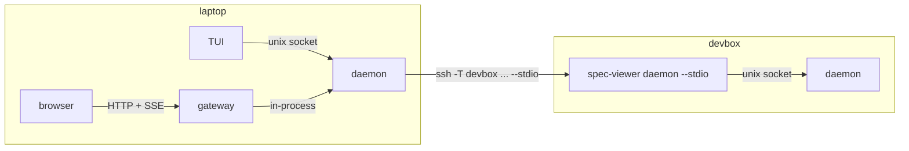
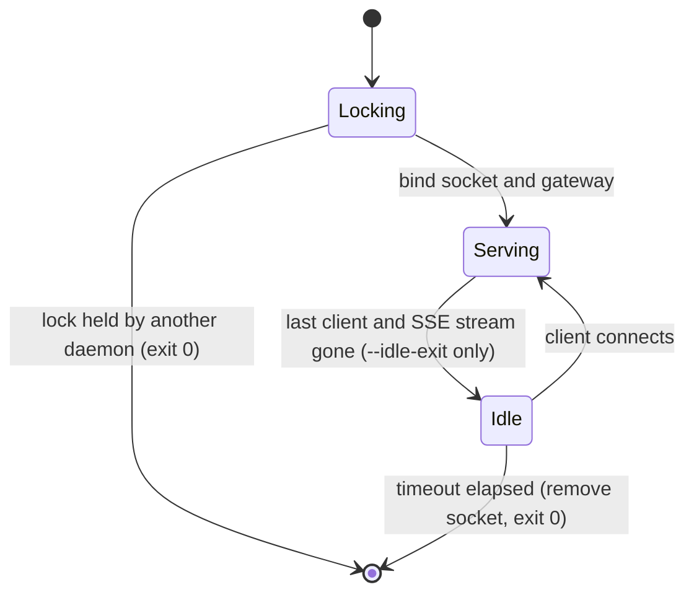

## Why

Each `spec-viewer` process builds two `Library` instances, one for its terminal and one for its own
web server. A frontend can therefore only show the host it runs on, the web app dies with its
terminal, and a second session of a project serves a different URL. Specs often live on remote
dev hosts, and a Rex-native frontend is planned once Rex blocks exist; neither fits a design where
each renderer reads the corpus in-process. This spec moves the corpus behind one daemon per host,
makes every frontend a client of it, and lets the local daemon reach remote hosts over SSH.

- `[G-1]` One frontend, terminal or browser, browses the plans and specs of the local host and of
  configured remote hosts.
- `[G-2]` The daemon serves semantic data, not presentation, so a new frontend such as a Rex block
  renders it without changes to the daemon.
- `[G-3]` The web app has one URL per machine that outlives any terminal session.
- `[NG-1]` No Rex frontend: this spec only keeps the protocol renderable by one.
- `[NG-2]` No listener beyond loopback: remote hosts are reached through SSH, and `[web]` loses
  `bind`, `cert`, and `key`.
- `[NG-3]` No authentication beyond SSH and Unix socket permissions.
- `[NG-4]` No editing: the daemon never writes to a worktree.
- `[NG-5]` No multi-hop: a remote daemon never forwards to another host.

## Design

- `[PI-1]` Every frontend is a protocol client, the web gateway included; only the daemon holds a
  `Library`.
- `[PI-2]` Semantic over the wire: the daemon sends `Document`, the corpus tree, and change events.
  ANSI, HTML, or block rendering belongs to the frontend.
- `[PI-3]` One protocol on every transport: the Unix socket, SSH stdio, and the in-process stream
  carry the same messages.
- `[PI-4]` SSH is the trust boundary between hosts; the Unix socket's directory mode is the boundary
  between users.



| Decision                      | Choice                                                                                                                                                                                                                                                                                                  | Rationale                                                                                                                                 |
| ----------------------------- | ------------------------------------------------------------------------------------------------------------------------------------------------------------------------------------------------------------------------------------------------------------------------------------------------------- | ----------------------------------------------------------------------------------------------------------------------------------------- |
| `[KD-1]` Framing              | One JSON object per line, both directions, with `serde_json`                                                                                                                                                                                                                                            | Already a dependency; a socket can be inspected with `socat`                                                                              |
| `[KD-2]` Wire types           | `serde` derives on the existing `parser`, `core`, and `source` types; a fixture JSON snapshot pins them, and any snapshot change bumps `PROTOCOL`                                                                                                                                                       | No mirrored JSON types to keep in sync; an accidental wire change fails CI                                                                |
| `[KD-3]` Crates               | `crates/protocol`: messages, framing, `Client`, and re-exports of the wire types and `search`. `crates/daemon`: server, hub, lifecycle, gateway startup. `render-web` and `render-tui` depend on `protocol` instead of `core`                                                                           | Frontends cannot reach `Library` by construction (`[PI-1]`)                                                                               |
| `[KD-4]` Local transport      | Unix socket `daemon-v<PROTOCOL>.sock` in a `0700` per-user directory                                                                                                                                                                                                                                    | Old and upgraded binaries each keep a daemon of their own protocol until the old one idles out                                            |
| `[KD-5]` Single instance      | The daemon takes an exclusive `flock` on `daemon-v<PROTOCOL>.lock` before binding; a daemon that loses the lock exits 0                                                                                                                                                                                 | Two frontends spawning at once end with one daemon                                                                                        |
| `[KD-6]` Spawn                | A frontend that cannot connect runs `current_exe() daemon --idle-exit 300` detached (`setsid`, output to `daemon.log`) and retries for 2 s                                                                                                                                                              | `spec-viewer .` needs no setup                                                                                                            |
| `[KD-7]` Idle exit            | A daemon started with `--idle-exit` exits after that many seconds with no socket client and no SSE stream; `spec-viewer daemon` alone never idles out                                                                                                                                                   | Auto-spawned daemons clean up; one run by launchd or systemd keeps bookmarks working                                                      |
| `[KD-8.2]` Remote hosts | The hub runs each host's `command` when the daemon starts and speaks the protocol on its stdio. A failed or lost connection retries with backoff up to 120 s, and a request to a lost host retries at once. A host connecting or dropping sends `Changed` to every watch | Remote worktrees join merged projects (`[KD-17]`) without a request naming the host; `[VC-5]`'s next request reconnects without waiting out the backoff |
| ~~`[KD-8.1]` Remote hosts~~ | ~~The hub runs each host's `command` when the daemon starts and speaks the protocol on its stdio. A failed or lost connection retries with backoff up to 120 s. A host connecting or dropping sends `Changed` to every watch~~ | ~~Remote worktrees join merged projects (`[KD-17]`) without a request naming the host; nothing listens on the remote host~~ |
| ~~`[KD-8]` Remote hosts~~     | ~~The hub runs the host's `command` and speaks the protocol on its stdio. It connects on the first request, reconnects on the next request after a failure, and closes after 300 s idle~~                                                                                                               | ~~Nothing listens on the remote host; `ssh` config, agents, and jump hosts apply unchanged~~                                              |
| `[KD-9]` Stdio relay          | `spec-viewer daemon --stdio` relays stdin and stdout to its host's socket, spawning the daemon per `[KD-6]`                                                                                                                                                                                             | Remote terminal sessions and the hub share one daemon, one watch, and one cache per worktree                                              |
| `[KD-10]` Routing             | A request names `host`; `None` is the receiving daemon. The hub forwards with `host: None`; a request with a host reaching a daemon with no such `[[host]]` fails `UnknownHost`                                                                                                                         | Enforces `[NG-5]` without a hop count                                                                                                     |
| `[KD-11]` Watches             | One debounced watch per worktree, shared by every subscriber and dropped with the last one; it also covers the user config and the worktree `.spec-viewer.toml`                                                                                                                                         | N clients cost one `notify` watcher                                                                                                       |
| `[KD-12.2]` Config source     | User settings come from the user config of the host the frontend runs on. Repository settings come from the worktree's own `.spec-viewer.toml`, except that a remote worktree of a project with a local worktree reads the local main worktree's file, live                                             | The clones share one repository, so the local copy is the one being edited; herdr likewise applies the client's settings on every machine |
| ~~`[KD-12.1]` Config source~~ | ~~User settings come from the user config of the host the frontend runs on, on every host it browses; repository settings come from the worktree's `.spec-viewer.toml`, wherever it is (`[CT-5]`)~~                                                                                                     | ~~Herdr does the same: the client's theme and keys apply on every machine, and nothing is copied to remote hosts~~                        |
| ~~`[KD-12]` Config split~~    | ~~The daemon reads project sections; frontends read frontend sections (`[CT-5]`)~~                                                                                                                                                                                                                      | ~~A shared daemon cannot apply one session's `--config` or `--theme`~~                                                                    |
| `[KD-13]` Config reload       | A change to a project-section file reloads that worktree's config and emits `Changed`                                                                                                                                                                                                                   | A long-lived daemon would otherwise keep a stale config until it exits                                                                    |
| `[KD-14]` Gateway             | Every daemon serves the web app on `127.0.0.1:<web.port>`, default `4747`. A port held by another process leaves the daemon without a gateway and `Welcome.web` empty                                                                                                                                   | A fixed port gives one URL per machine (`[G-3]`); `ports.toml` goes away                                                                  |
| `[KD-15]` Search              | Stays the pure `spec_viewer_core::search` over a fetched corpus; the protocol has no search request                                                                                                                                                                                                     | The TUI searches per keystroke without a round trip; the gateway calls it in-process                                                      |
| `[KD-16.1]` Config layers     | A connection's `Hello` carries the project sections of its host's user config, or `None` for the daemon's own. `Override` replaces a worktree's file for that connection. The hub sends its own user layer and the overrides of `[KD-12.2]`. A daemon keeps one `Library` per distinct effective config | Two frontends on different hosts browsing one remote daemon each keep their own statuses and tabs                                         |
| ~~`[KD-16]` User layers~~     | ~~A connection's `Hello` carries the project sections of its host's user config, or `None` for the daemon's own. The hub sends its own layer, and a daemon keeps one `Library` per distinct layer~~                                                                                                     | ~~Two frontends on different hosts browsing one remote daemon each keep their own statuses and tabs~~                                     |
| `[KD-17]` Project identity    | Projects on different hosts with the same normalized `remote.origin.url` merge into one project whose worktrees carry their `host`. A local project leads the merge; a project without `origin` never merges                                                                                            | A remote clone reads as one more worktree of the project the user knows                                                                   |
| `[KD-18]` Known projects      | Each daemon records the project paths it resolves in `$XDG_STATE_HOME/spec-viewer/projects.toml` (else `~/.local/state/spec-viewer/`). `Projects` lists those that still resolve                                                                                                                        | The dropdown and merged projects survive idle exit and restarts                                                                           |

## Outcome

- `[SO-1]` One daemon per host and protocol version serves every frontend on that host. A
  frontend starts it on demand, and it exits when idle. — demonstrated by `[VC-1]`, `[VC-2]`
- `[SO-2]` A terminal or browser on the local host browses a configured remote host over SSH, with
  live reload and no listener on the remote host. — demonstrated by `[VC-4]`, `[VC-5]`
- `[SO-3]` The protocol carries the semantic document and corpus, versioned and pinned by a
  snapshot, so a new frontend renders them itself. — demonstrated by `[VC-3]`
- `[SO-4]` The web app is served at `http://localhost:4747` for every project and host, with the
  host in the URL. A URL opens any worktree on its host, and the worktree dropdown lists every
  project opened on each host. — demonstrated by `[VC-6]`
- `[SO-5]` An edit to a worktree's `.spec-viewer.toml` or the user config's project sections
  applies to open frontends without restarting. — demonstrated by `[VC-7]`
- `[SO-6]` `ports.toml`, `[web] bind`, `cert`, `key`, the TLS code, `--config`, and frontend
  sections in a worktree `.spec-viewer.toml` are removed.
  — demonstrated by `[VC-8]`
- `[SO-7.1]` A remote host shows documents with the statuses, tabs, and chips of the local user
  config. A remote clone of a local project appears as one more worktree of it, in the terminal
  picker and the web dropdown, and follows the local `.spec-viewer.toml` as it is edited.
  — demonstrated by `[VC-9]`, `[VC-10]`, `[VC-11]`, `[VC-12]`
- ~~`[SO-7]` A remote host shows documents with the statuses, tabs, and chips of the local user
  config, plus the repository's own `.spec-viewer.toml`.~~

## Contracts

### [CT-1] Messages

Kind: schema · Anchor: `crates/protocol/src/messages.rs`

```rust
pub const PROTOCOL: u32 = 1;

#[serde(tag = "type")]
pub enum ClientMessage {
    Hello { protocol: u32, user: Option<Layer> },                // first line, exactly once
    Request { id: u64, host: Option<String>, request: Request }, // id unique per connection
    User { user: Layer },                                        // the sender's user config changed
    Override { worktree: PathBuf, layer: Option<Layer> },        // replaces the worktree's file; None restores it
}

/// The `[[tab]]`, `[[status]]`, and `[[chip]]` of one config file, unmerged.
pub struct Layer { tabs: Option<Vec<TabConfig>>, statuses: Option<Vec<StatusConfig>>, chips: Option<Vec<ChipConfig>> }

pub enum Request {
    Hosts,                                    // → Hosts
    Projects,                                 // → Projects: the known projects ([KD-18]) of this daemon and its connected hosts, merged ([KD-17])
    Resolve { root: PathBuf },                // → Resolved; root is absolute on the target host
    Project { key: PathBuf },                 // → Project: a fresh worktree list
    Corpus { worktree: PathBuf },             // → Corpus
    Open { worktree: PathBuf, path: String }, // → Opened
    Watch { worktree: PathBuf },              // → Watching; then Changed { id } per burst, id = this request's id
    Unwatch { id: u64 },                      // → Unwatched
}

pub struct Project { key: PathBuf, name: String, path: PathBuf, origin: Option<String>, worktrees: Vec<Worktree> }
pub struct Worktree { host: Option<String>, name: String, main: bool, path: PathBuf } // host: None = the answering daemon

#[serde(tag = "type")]
pub enum DaemonMessage {
    Welcome { protocol: u32, version: String, web: Option<String> }, // web: the gateway URL
    Response { id: u64, result: Result<Response, Error> },
    Changed { id: u64 },
    HostDown { host: String },  // once per lost connection; open watches on it resume with a Changed on reconnect
}

pub enum Response {
    Hosts(Vec<HostState>),      // HostState { name, connected: bool, error: Option<String> }: error while disconnected
    Projects(Vec<Project>),
    Resolved { project: Project, worktree: usize, statuses: Vec<StatusConfig> },
    Project(Project),
    Corpus(Corpus),
    Opened(Opened),
    Watching,
    Unwatched,
}

pub enum Error {
    Protocol { daemon: u32, client: u32 },
    UnknownHost,
    HostUnreachable { message: String },
    NotAProject,                // root is not inside a Git worktree
    UnlistedWorktree,           // worktree not listed by its project
    Forbidden,                  // DocError::Forbidden
    NotFound,                   // DocError::NotFound
    Config { message: String }, // the worktree's config does not load
}
```

A `Hello` whose `protocol` differs from the daemon's gets `Welcome` and then
`Response { id: 0, result: Err(Protocol { .. }) }`, and the connection closes. `Resolved.worktree`
is the index of the worktree containing `root`, by longest path prefix. `statuses` carries the
project's configured names and colours, which the frontend resolves against its own palette.

The connection's layer sits between the embedded default and the worktree file. A `User` or
`Override` message replaces a layer and sends `Changed` to every watch on that connection. A
daemon whose own user config changes sends `User` on each hub connection. While a remote worktree
of a project with a local worktree is in use, the hub watches the local main worktree's
`.spec-viewer.toml` and sends `Override` with its project sections on every change.

`origin` is `remote.origin.url` with the scheme, user, port, trailing `/`, and `.git` removed, the
scp form `host:path` read as `host/path`, and the host lowercased: `git@GitHub.com:o/r.git` and
`https://github.com/o/r` are both `github.com/o/r`. The hub answers `Resolve`, `Project`, and
`Projects` with merged projects; `Resolved.worktree` indexes the merged list, and a frontend sends
each request to its worktree's `host`. A connection whose `Hello` carries a user layer, a hub's, gets
this host's projects unmerged, so a remote daemon never reaches further hosts (`[NG-5]`).

### [CT-2] Client

Kind: api · Anchor: `crates/protocol/src/client.rs#Client`

```rust
impl Client {
    /// Connects to this host's daemon, spawning it per [KD-6], and completes the handshake.
    pub fn connect() -> Result<Client, Error>;
    /// Handshake over a reader and a writer: the in-process gateway, tests, and the hub's SSH child.
    /// `user` is sent in `Hello`; only the hub passes `Some`.
    pub fn over(reader: impl Read + Send + 'static, writer: impl Write + Send + 'static, user: Option<Layer>) -> Result<Client, Error>;
    /// `over` a socket, shut down once the client and its watches are dropped.
    pub fn over_socket(stream: UnixStream, user: Option<Layer>) -> Result<Client, Error>;
    pub fn web_url(&self) -> Option<&str>;
    pub fn hosts(&self) -> Result<Vec<HostState>, Error>;
    pub fn projects(&self, host: Option<&str>) -> Result<Vec<Project>, Error>;
    pub fn resolve(&self, host: Option<&str>, root: &Path) -> Result<Resolved, Error>;
    pub fn project(&self, host: Option<&str>, key: &Path) -> Result<Project, Error>;
    pub fn corpus(&self, host: Option<&str>, worktree: &Path) -> Result<Corpus, Error>;
    pub fn open(&self, host: Option<&str>, worktree: &Path, path: &str) -> Result<Opened, Error>;
    /// Dropping the watch sends Unwatch.
    pub fn watch(&self, host: Option<&str>, worktree: &Path) -> Result<Watch, Error>;
    pub fn call(&self, host: Option<&str>, request: Request) -> Result<Response, Error>;
    pub fn send_user(&self, user: Layer) -> Result<(), Error>;                            // the hub's User
    pub fn send_override(&self, worktree: &Path, layer: Option<Layer>) -> Result<(), Error>; // the hub's Override
}
pub struct Watch; // derefs to Receiver<Event>
pub enum Event { Changed, HostDown }
```

Calls block, matching the synchronous workspace. One reader thread per client routes responses by
`id` and events by watch. A lost daemon connection fails pending and later calls with
`HostUnreachable`.

### [CT-3] Daemon lifecycle

Kind: invariant · Anchor: `crates/daemon/src/lifecycle.rs#run`

```text
$XDG_RUNTIME_DIR/spec-viewer/      (else $TMPDIR/spec-viewer-<uid>/), mode 0700
├── daemon-v<PROTOCOL>.lock
├── daemon-v<PROTOCOL>.sock
└── daemon.log
```



A socket file left by a crashed daemon is removed by the next daemon after it takes the lock. A
directory with a mode other than `0700`, or owned by another user, is an error naming its path.

### [CT-4] Command line

Kind: api · Anchor: `crates/spec-viewer/src/cli.rs#parse`

```text
spec-viewer [ROOT] [--host NAME] [--theme light|dark]
spec-viewer daemon [--stdio | --idle-exit SECONDS]
```

`--host` opens `ROOT` on a configured remote host; `ROOT` is then required and absolute. Without
`--host`, `ROOT` resolves against the working directory before it is sent. A client error exits 1
with `spec-viewer: <message>`; for `Protocol` the message names the host and both versions.
`--config` is removed and exits 1 with `spec-viewer: unknown option: --config`; a frontend reads only
its host's user config.

### [CT-5] Config split

Kind: config · Anchor: `crates/config/default.toml`

```toml
# Project sections: embedded default < the frontend host's user config (Hello.user) < the .spec-viewer.toml [KD-12.2] selects
[[tab]]     # unchanged
[[status]]  # unchanged
[[chip]]    # unchanged

# Daemon sections: its host's user config only
[web]
port = 4747

[[host]]
name = "devbox"
ssh = "devbox"                    # runs: ssh -T devbox spec-viewer daemon --stdio
# command = ["kubectl", "exec", "-i", "pod", "--", "spec-viewer", "daemon", "--stdio"]  # instead of ssh

# Frontend sections: read by each frontend from its host's user config
[keys]      # unchanged; the gateway uses its daemon host's
[theme]     # unchanged
[tui]       # unchanged
```

A `[[host]]` sets exactly one of `ssh` and `command`, and names are unique. `[web] bind`, `cert`,
or `key` is an unknown-key error. A worktree `.spec-viewer.toml` holds project sections only: a
daemon or frontend section in it is a config error naming the file.

### [CT-6] Gateway

Kind: api · Anchor: `crates/render-web/src/server.rs#start`

The routes of `spec/web-ui.spec.md` `[CT-2]` take an optional `host` parameter; the client's URL
state adds `host=<name>` (`spec/web-ui.spec.md` `[CT-3]`), and the link the terminal's `o` opens
carries it. `wt` may name any worktree that `Resolve` accepts on that host, and opening it adds
its project to that host's known projects. The worktree dropdown lists every merged project from
`/api/projects`, each worktree labelled with its host:

```text
GET /api/projects → { projects: [{ name, path, origin?, worktrees: [{ host?, name, main, path }] }], unreachable: [{ host, error }] }
GET /theme.css?host=&wt= → the worktree's statuses as --tone-N, coloured from the gateway host's palette
```

A request whose `Host` header is not `localhost`, `127.0.0.1`, or `[::1]` with the gateway's port is
`403`, which blocks DNS rebinding. An unreachable host is `502` with the error message, and the
client shows it in place of the corpus.

## Acceptance

- `[VC-1]` Given no running daemon and an empty runtime directory, when two clients call
  `Client::connect` concurrently, then one daemon process exists and both receive the same
  `Resolved` for a fixture worktree. — demonstrates `[SO-1]`
- `[VC-2]` Given a daemon started with `--idle-exit 1`, then it stays up while a socket client or an
  SSE stream is open, and removes its socket and exits within 3 s after the last one closes; a
  daemon started without the flag is still serving after 3 s with no client. — demonstrates `[SO-1]`
- `[VC-3]` Given `fixtures/dialect.spec.mdx`, then the `Opened` and `Corpus` JSON match their
  committed snapshots and deserialize to values equal to the in-process ones. A client sending
  `protocol: 0` gets `Protocol { daemon: 1, client: 0 }`. — demonstrates `[SO-3]`
- `[VC-4]` Given a local daemon with `[[host]] name = "box", command = ["env",
  "XDG_RUNTIME_DIR=<second dir>", <test binary>, "daemon", "--stdio"]`, when a client resolves
  worktree B with `host: Some("box")`, then B is recorded in the box daemon's `projects.toml` and
  not in the local one. A write to a document in B sends `Changed` to a watch made through the local daemon. A
  request with `host: Some("box")` sent directly to the box daemon fails `UnknownHost`.
  — demonstrates `[SO-2]`
- `[VC-5]` Given a watch on `box`, when its daemon is killed, then the watcher receives `HostDown`
  and a `corpus` call fails `HostUnreachable`. When the box daemon is reachable again, the next
  request reconnects and the watch receives `Changed`. — demonstrates `[SO-2]`
- `[VC-6]` Given a gateway, then `/api/doc?host=box&wt=<B>&path=…` serves the `box` document,
  and the next `/api/projects` lists B's worktree with `host: "box"`. A request with `Host: evil.example:4747` is `403`, and an unreachable host is `502`. Given the port
  already bound by another listener, the daemon serves its socket and `Welcome.web` is empty.
  — demonstrates `[SO-4]`
- `[VC-7]` Given an open watch, when the worktree's `.spec-viewer.toml` gains a `[[tab]]`, then the
  watch receives `Changed` and the next `corpus` lists the new tab. — demonstrates `[SO-5]`
- `[VC-8]` Given a user config with `[web] bind`, or a `[[host]]` with both `ssh` and `command`,
  then loading fails naming the key; given a worktree file with `[[host]]`, `[web]`, `[keys]`,
  `[theme]`, or `[tui]`, `Resolve` fails `Config` naming the file. `spec-viewer --config x.toml`
  exits 1 with `spec-viewer: unknown option: --config`. — demonstrates `[SO-6]`
- `[VC-9]` Given a local user config adding status `shipped`, a box user config without it, and a
  box document with `status: shipped`, then the document opened through the hub has a known
  `shipped` status, and opened by a client of the box daemon it does not. When the local user
  config drops `shipped`, a watch through the hub receives `Changed` and the status becomes
  unknown. — demonstrates `[SO-7.1]`
- `[VC-10]` Given local worktree A with origin `git@GitHub.com:o/r.git`, box worktree B with
  origin `https://github.com/o/r`, and box worktree C with no origin and A's directory name, when
  box connects, then `resolve(None, A)` lists B with `host: Some("box")` and does not list C.
  — demonstrates `[SO-7.1]`
- `[VC-11]` Given A's `.spec-viewer.toml` with tab `notes` and B's with tab `other`, then
  `corpus(Some("box"), B)` lists `notes` and not `other`. When A's file renames the tab, a watch on
  B made through the local daemon receives `Changed` and the next corpus lists the new name. Given
  no local clone of B, `corpus(Some("box"), B)` lists `other`. — demonstrates `[SO-7.1]`
- `[VC-12]` Given a daemon that resolved B, when it exits and a new one starts, then `Projects`
  lists B; after B's directory is deleted, it does not. — demonstrates `[SO-7.1]`

## Caveats

- `[C-1]` Unix only: the socket, `flock`, and `setsid` have no Windows path.
- `[C-2]` A remote host needs `spec-viewer` of the same `PROTOCOL` on its `PATH`, or a `command`
  naming it.
- `[C-3]` TUI calls block the event loop for one round trip, which over SSH is network latency on
  every document open.
- `[C-4]` A bookmark only loads while a daemon runs; run `spec-viewer daemon` under launchd or
  systemd to keep one up.
- `[C-5]` Raw HTML in a document runs in the gateway's origin, which can fetch every host's
  documents. `spec/web-ui.spec.md` `[C-1]` now spans every configured host.
- `[C-6.1]` The terminal snapshot tests (`crates/render-tui/tests/tui.rs`) and the web server tests
  (`crates/render-web/tests/server.rs`) pass unchanged in output against an in-process daemon. The
  server's TLS and preferred-port tests go with the features `[SO-6]` removes.
- ~~`[C-6]` The terminal snapshot tests (`crates/render-tui/tests/tui.rs`) and the web server tests
  (`crates/render-web/tests/server.rs`) must pass unchanged in output, run through `Client::over`
  against an in-process daemon.~~
- `[C-7]` Accepting this spec supersedes `spec/web-ui.spec.md` `[G-2]`, `[NG-2]`, `[NG-3]`,
  `[KD-1]`, `[KD-6]`, `[KD-7]`, `[SO-4]`, `[CT-2]` (`start`, `/api/projects`), `[CT-4]`, `[CT-5]`, `[CT-6]`, `[C-4]`, `[VC-5]`,
  `[VC-7]`, `[VC-8]`, and `spec/terminal-ui.spec.md` `[PI-2]`, `[KD-8]`, `[KD-9]`, `[NG-4]`, the
  `--config` layer of `[CT-4]` and `[CT-5]`, and the `--config` clauses of `[VC-7]`. Those
  specs are amended in the change that implements this one.
- `[C-8]` Another user on a host can read, through its loopback gateway, the Markdown of any Git
  worktree the daemon's user can read.
